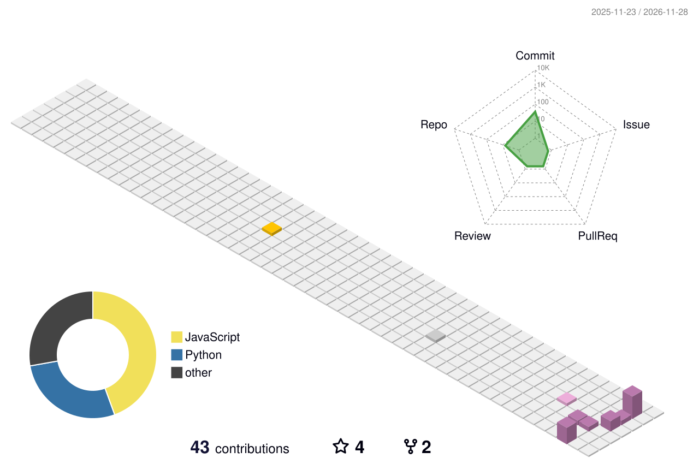

<!-- 打字机问候 -->

<!-- 访问计数 -->

## 关于我 | About Me

**AI Agent 与浏览器自动化方向开发者**，喜欢把重复的事情交给 AI —— 相信「录一次，处处复现」。

主理 [**Dejavu**](https://github.com/ekkoxusu/Dejavu)：Chrome 扩展 + 通用 AI Skill，把网页操作录制成标准数据包，交给任意 AI Agent 完整回放。

## 🧰 技术栈 | Tech Stack

## 📊 GitHub 统计 | Stats

## 🚀 我的代表作 | Featured Project

<h3><a href="https://github.com/ekkoxusu/Dejavu">🎬 Dejavu — 录一次，AI 处处复现</a></h3>

Chrome 扩展 + 通用 AI Skill：把网页上的任何操作录制成标准数据包，交给任意 AI Agent 完整回放。

## 🐍 贪吃蛇吃掉我的提交 | Snake

<picture>
  <source media="(prefers-color-scheme: dark)" srcset="dist/github-snake-dark.svg" />
  <source media="(prefers-color-scheme: light)" srcset="dist/github-snake.svg" />
  
</picture>

## 🗿 3D 贡献图 | 3D Contributions

---

觉得 <a href="https://github.com/ekkoxusu/Dejavu">Dejavu</a> 有用？去点个 ⭐ Star 吧！

